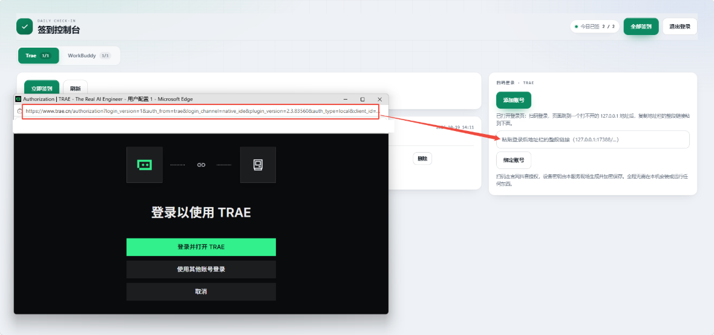
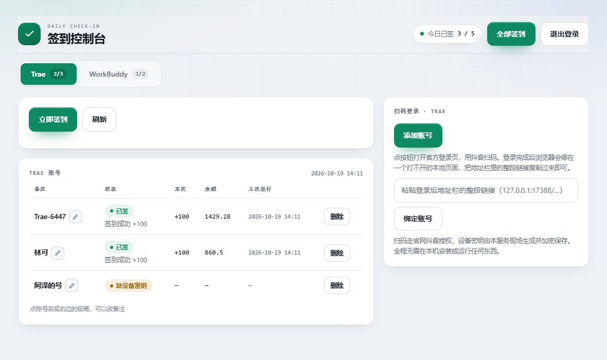

# Trae + WorkBuddy 每日签到 · Cloudflare Worker

把两个平台的每日签到都搬到云端：**不用开电脑、不用装客户端、不用守时间**。各扫一次码把账号托管进去，之后 Worker 自己续期令牌、按时签到、记录结果。

**全部代码在 `worker.js` 一个文件里**——没有构建、没有依赖、没有 import，直接粘进 Cloudflare 网页控制台就能跑。

|        | Trae                           | WorkBuddy    |
| ------ | ------------------------------ | ------------ |
| 加账号    | 抖音扫码                           | 微信扫码         |
| 凭据     | refreshToken + Worker 生成的设备密钥对 | refreshToken |
| 签到内容   | 每日积分领取                         | 每日签到         |
| 列表额外信息 | 余额、本次到账                        | 连签天数、本期累计    |

两个平台共用一套部署、一个控制台、一条定时任务，账号数据同存一个 KV，按 `trae:` / `wb:` 前缀隔离，互不影响。

---

## 一、部署

全程在 Cloudflare 网页控制台完成，不用装任何工具、不用命令行。

1. 打开 [Cloudflare Dashboard](https://dash.cloudflare.com/) → **Workers & Pages** → **Create**
2. 起个名字（例如 `signin-all`），创建后点 **Edit code**
3. 把 `worker.js` 全文粘进去 → **Deploy**
4. 回到 Worker 设置页，加下面这组绑定：

| 类型              | 名称            | 值                                              |
| --------------- | ------------- | ---------------------------------------------- |
| KV Namespace 绑定 | `KV`          | 先到 **Storage & Databases → KV** 新建一个命名空间，回来选中它 |
| Secret          | `MASTER_KEY`  | 32 字节随机值的 base64，两个平台共用                        |
| Secret          | `ADMIN_TOKEN` | 你自己定的**页面登录密码**                                |
| Secret          | `CRON_SECRET` | 可选。给 `/cron` 用的独立口令，不配则回落到 `ADMIN_TOKEN`       |

1. **Settings → Triggers → Cron Triggers** 加一条 `10 0 * * *`（= 北京时间 08:10）

生成主密钥：浏览器按 F12 打开控制台，粘贴执行

```js
btoa(String.fromCharCode(...crypto.getRandomValues(new Uint8Array(32))))
```

> 32 字节的 base64 一定是 **44 个字符、以 `=` 结尾**。长度不对就是复制漏了。

> `MASTER_KEY` 丢了 = KV 里的令牌全部解不开，只能重新扫码。**存进密码管理器。**

---

## 二、第一次打开

部署后拿到一个形如 `https://signin-all.<你的子域>.workers.dev` 的地址。

1. 打开它 → 输入 `ADMIN_TOKEN` → 点「登录」
2. 登录成功自动载入两个平台的账号列表，都是空的即为正常

登录状态记在本机浏览器（localStorage），下次打开自动登录。公共电脑用完点右上角「退出登录」清除。

> **Trae 只认 `127.0.0.1` 回调**：官网往 `<本机>/...` 回送授权码，换成任何域名都会让登录页直接报「网络错误」。所以扫码的最后一步是「复制地址栏链接粘回来」，见下一节。

---

## 三、添加账号

控制台顶部有两个标签页：**Trae** 和 **WorkBuddy**，各自独立加号。

### Trae：抖音扫码

在 Trae 标签页右侧点 **「添加账号」**：

1. 弹出官方授权页 `www.trae.cn/authorization`
2. 用抖音扫码并确认
3. 浏览器会跳到一个**打不开的** `http://127.0.0.1:17388/authorize?…` 页面 —— 这是正常的，本机没有服务在监听
4. 在那个页面上按 `Ctrl+C` 复制地址栏（或直接全选地址栏复制），回到控制台**按一次 `Ctrl+V`** —— 输入框收到内容就会自动绑定，不用再点按钮

链接里带着一次性授权码（`AuthCode`），Worker 拿它换 refreshToken 并加密入库。整个过程不需要在本机跑任何程序，粘一次就完成，之后靠 refreshToken 自动续期。



授权链接 15 分钟内有效，`AuthCode` 只能用一次；粘错了重新点一次扫码即可。

**为什么不能全自动**：Trae 只把授权码回送到 `127.0.0.1` 上的某个端口，也就是**你自己电脑**。云端 Worker 没法访问你电脑上的端口，跨域也读不到那个弹窗的地址栏，Trae 又没有设备码授权可以绕开回调，所以最后这一下只能由浏览器里的人来完成。

**本项目不采用任何本机程序**：不装客户端、不跑本地转发脚本、不监听端口。代价就是每个人每个账号多按一次 `Ctrl+V`，收益是任何一台设备打开网页就能用。

> 设备密钥（ECDSA P-256）由 Worker 现场生成并加密保存，续期时的设备证明也由自己签名——**不需要装 Trae 客户端**。

### WorkBuddy：微信扫码

在 WorkBuddy 标签页点 **「添加账号」**：

1. 新窗口打开官方登录页（`www.codebuddy.cn/login`），二维码**由官方页面渲染，本服务不接触你的微信信息**
2. 微信扫码 → 手机上点确认
3. Worker 轮询到授权结果 → 令牌加密存进 KV → 账号自动出现在列表里，登录窗口会自动关闭

二维码有效期约 5–6 分钟，超时点「添加账号」重试。

> **为什么整页打开而不是嵌在控制台里**：官方登录页响应头带了 `frame-ancestors 'self'`，禁止被第三方页面内嵌，硬塞进 iframe 只会是一片空白。所以改成在新窗口打开，扫码体验一样，只是多一个窗口。

账号的**备注名优先取自账号昵称**，取不到时是 `Trae-xxxx` / `账号-xxxx`，点备注旁的铅笔随时能改，不用手动填表单。每个平台都能放多个账号，互不影响。

---

## 四、控制台



> 图里是 Trae 标签页，选中的标签页是实心绿底，未选中是浅底灰字。WorkBuddy 标签页结构相同：账号表的「本次 / 余额」两列换成「连签 / 本期」，右侧换成微信扫码登录，顶栏「今日已签」显示的是两个平台的合计。截图里的「添加账号」弹窗见上一节。

| 区域       | 说明                                            |
| -------- | --------------------------------------------- |
| 顶栏「今日已签」 | 两个平台合计：已签数 / 账号总数                             |
| 全部签到     | 两个平台一起跑一轮，等同定时任务的逻辑                           |
| 标签页      | Trae / WorkBuddy 分别管理，选中项为实心绿底高亮；标签上的数字是当日已签数 |
| 立即签到     | 只跑当前标签页的账号                                    |
| 刷新       | 重新拉取列表与状态                                     |
| 退出登录     | 清除本机保存的密码，回到登录页                               |

### Trae 账号表

备注 / 状态 / 本次 / 余额 / 上次运行 / 删除

> 备注名右边有一支铅笔，点名字或铅笔都能就地改名：光标直接落在原名字上，回车或点别处保存，`Esc` 放弃，全程不弹窗、不刷新整页。
>
> 新账号为什么叫 `Trae-xxxx`：Trae 的授权回调只回传 AuthCode 和令牌，不带昵称，兑换令牌的响应里也没有，所以只能给个设备号后缀。WorkBuddy 登录后会多调一次用户资料接口，能取到昵称就直接显示昵称，取不到才叫 `账号-xxxx`。

| 标签      | 含义                               |
| ------- | -------------------------------- |
| 已签      | 今天签上了，下方显示到账积分                   |
| 今日未签    | 今天还没跑，或还没到定时时间                   |
| 限流 N 分钟 | 服务端返回限流，Worker 已按账号冷却，到点后下一轮自动重试 |
| 待确认     | 提交成功但服务端未回执到账，下一轮会再查一次           |
| 签到失败    | 请求出错，下方显示原因                      |
| 令牌失效    | refreshToken 失效，需要重新扫码           |
| 缺设备密钥   | 账号记录异常（极少见），重新扫码即可               |

### WorkBuddy 账号表

备注 / 状态 / 连签 / 本期 / 上次运行 / 删除

> 改备注的方式与 Trae 一致，点名字或铅笔就地编辑。两个平台的备注互不影响。

| 标签   | 含义                     |
| ---- | ---------------------- |
| 已签   | 今天签上了                  |
| 今日未签 | 今天还没跑                  |
| 签到失败 | 请求出错，下方显示原因            |
| 令牌失效 | refreshToken 失效，需要重新扫码 |

> 所有状态都由**当天**现算（按北京时间），不存在「昨天签过、今天还显示已签」的情况。

界面跟随系统自动切换深色/浅色；宽屏两栏（左账号、右扫码），窄于 1080px 变单栏，手机上账号表退化成卡片列表。

---

## 五、定时任务

**Cloudflare 的 Cron 只认 UTC。** 左列是填进 Cloudflare 的值，右列是北京时间：

| 设置       | Cron（填这个）     | 对应北京时间       | 作用           |
| -------- | ------------- | ------------ | ------------ |
| **必设一条** | `10 0 * * *`  | **08:10**    | 每天两个平台各跑一遍   |
| 选填  | `20 16 * * *` | 次日 **00:20** | 多一次机会，失败能自动补 |

**只设一条完全够用**：每次触发里 Trae 和 WorkBuddy 会依次各跑一遍，不是两个平台各配一条。

第二条的意义是「一天两次机会」，而且对 Trae 尤其有用：

- 北京时间 0 点前后是 Trae 的**早窗**，限流冷却只按 12 分钟算；白天则要 55 分钟
- 也就是说 00:20 那趟如果撞上 9074，08:10 那趟大概率能补上
- 只留 08:10 一条也不会签不上，只是撞限流时当天没有第二次自动机会，得手动点一下「立即签到」

> 签到接口幂等（今天已签会直接返回"已签"，不重复加分），所以两条 cron 都留着、或者手动多点几次，都安全。

改时间：**Settings → Triggers → Cron Triggers**。

> 换算公式：**北京 = UTC + 8**。例如北京时间早上 9 点写成 `0 1 * * *`。

### 改用外部定时器（选填）

不想用 Cloudflare 自带 cron，或者想把签到并进已有的定时任务，可以从外面调 `/cron` 接口——跑的逻辑和「全部签到」一样。

```bash
curl -X POST "https://signin-all.你的子域.workers.dev/cron" \
  -H "X-Cron-Secret: 你的CRON_SECRET"
```

```bash
# 也可以放 query（GET / POST 都行）
curl "https://signin-all.你的子域.workers.dev/cron?key=你的CRON_SECRET"
```

返回两个平台各自的汇总：

```json
{
  "at": "2026-10-19T08:10:00.000 +08:00",
  "trae": {
    "at": "2026-10-19T08:10:01.000 +08:00",
    "accounts": 1,
    "checked": 1,
    "already": 0,
    "failed": 0,
    "results": [
      { "id": "ab12cd34", "label": "我的号", "state": "checked", "msg": "+100 积分" }
    ]
  },
  "wb": {
    "at": "2026-10-19T08:10:03.000 +08:00",
    "accounts": 1,
    "checked": 0,
    "already": 1,
    "failed": 0,
    "results": [
      { "id": "CSl88KP2yXIn", "label": "我的主号", "state": "skipped", "msg": "今日已完成" }
    ]
  }
}
```

- `checked` 这次真签上了；`already` 今天已经签过；`failed` 失败或令牌失效
- HTTP **401** = 口令不对；**500** = `CRON_SECRET` 和 `ADMIN_TOKEN` 都没配

GitHub Actions 示例：

```yaml
on:
  schedule:
    - cron: '10 0 * * *'        # UTC 00:10 = 北京 08:10
jobs:
  signin:
    runs-on: ubuntu-latest
    steps:
      - run: |
          curl -fsS -X POST "https://你的地址/cron" \
            -H "X-Cron-Secret: ${{ secrets.CRON_SECRET }}"
```

**注意**：这条接口只靠口令保护，别把带 `key` 的地址贴进公开仓库或聊天记录；怀疑泄露就换一个 `CRON_SECRET`。

> Cloudflare 的 cron 和 `/cron` **二选一即可**，两边都配也不会重复签到。

---

## 六、接口速查

所有管理接口都认三种口令写法：`X-Admin-Token: <token>`、`Authorization: Bearer <token>`、`?token=<token>`。

| 方法   | 路径                            | 说明                                                   |
| ---- | ----------------------------- | ---------------------------------------------------- |
| GET  | `/`                           | 控制台页面                                                |
| GET  | `/api/ping`                   | 校验密码                                                 |
| POST | `/api/run-all`                | 两个平台一起签，加 `?force=1` 强制重跑                            |
| POST | `/cron`                       | 定时入口，口令走 `X-Cron-Secret` 或 `?key=`                   |
| GET  | `/trae/api/list`              | Trae 账号列表                                            |
| POST | `/trae/api/run`               | Trae 签到，加 `?force=1` 强制                              |
| POST | `/trae/api/login/start`       | 生成抖音授权链接，无需 body                                     |
| GET  | `/trae/api/login/poll?trace=` | 查询扫码结果                                               |
| POST | `/trae/api/login/claim`       | 粘贴回调链接完成绑定，body `{"url":"..."}`                      |
| POST | `/trae/api/accounts/remove`   | 删除 Trae 账号，body `{"id":"..."}`                       |
| POST | `/trae/api/rename`            | 改 Trae 备注，body `{"id":"...","label":"..."}`（最长 40 字） |
| GET  | `/wb/api/list`                | WorkBuddy 账号列表                                       |
| POST | `/wb/api/run`                 | WorkBuddy 签到，加 `?force=1` 强制                         |
| POST | `/wb/api/login/start`         | 生成微信扫码会话                                             |
| GET  | `/wb/api/login/poll?state=`   | 查询扫码结果                                               |
| POST | `/wb/api/remove`              | 删除 WorkBuddy 账号，body `{"id":"..."}`                  |
| POST | `/wb/api/rename`              | 改 WorkBuddy 备注，body `{"id":"...","label":"..."}`     |
| GET  | `/oauth/callback`             | 预留的授权回调入口，供回调页与主面板同源时直接通知                            |

> `force=1` 只是跳过"今天签过就不请求"的本地判断，服务端本身幂等，不会重复加分。

---

## 七、常见问题

| 现象                               | 原因                               | 处理                                       |
| -------------------------------- | -------------------------------- | ---------------------------------------- |
| 登录提示「登录密码不正确」                    | `ADMIN_TOKEN` 填错                 | 检查有没有多打空格                                |
| 提示 `未配置 ADMIN_TOKEN`             | 这个 Secret 没建                     | 补建，名字要**完全等于** `ADMIN_TOKEN`             |
| 提示 `缺少 MASTER_KEY`               | Secret 没建或名字拼错                   | 名字要**完全等于** `MASTER_KEY`                 |
| 提示 `MASTER_KEY 必须是 32 字节`        | 主密钥复制不全                          | 重新生成，确认 44 字符且以 `=` 结尾                   |
| 提示 `MASTER_KEY 不是合法 base64`      | 粘进了换行或引号                         | 只复制字符串本身                                 |
| 提示 `未绑定 KV：…变量名填 KV`             | KV 没绑或绑定名写错                      | 绑定名必须**完全等于** `KV`                       |
| 列表是空的                            | 还没添加账号；或 cron 还没到点               | 扫码添加，然后点「立即签到」                           |
| 备注是一串 `Trae-xxxx` / `账号-xxxx`    | 那一次登录没拿到昵称（Trae 的回调本来就不带昵称）      | 点备注名或右侧铅笔就地改名，账号功能不受影响                   |
| Trae 扫码后停在「无法访问此网站」              | 正常现象，官网只回送 127.0.0.1             | 复制该页地址栏的整段链接，回控制台按一次 `Ctrl+V`            |
| Trae 登录页报「网络错误」                  | 打开的不是控制台生成的链接                    | 回控制台重新点「添加账号」，别手改链接里的回调地址                |
| 粘贴后报「地址里没找到 authCodeInfo / code」 | 复制时漏了 `?` 后的部分，或复制成了搜索页地址        | 先把地址栏全选再复制                               |
| Trae 显示「限流 N 分钟」                 | 服务端 9074 限流                      | 等冷却结束，下一轮自动重试；加一条 00:20 的 cron 更容易补上     |
| Trae 显示「令牌失效」                    | 很久没跑，或账号在别处登出过                   | 重新扫码                                     |
| WorkBuddy 登录窗口是空白页               | 浏览器把 `about:blank` 当广告拦了，或代理没加载完 | 重新点一次；仍空白就在状态里点链接直接打开                    |
| 提示「登录会话已过期」                      | 二维码超过有效期没扫                       | 重新扫码                                     |
| 一直没动静                            | cron 没配 / 时区搞错                   | 检查 Triggers 里那条 cron，注意填的是 UTC           |
| `/cron` 返回 401                   | `key` / `X-Cron-Secret` 填错       | 口令须等于 `CRON_SECRET`，没配时回落到 `ADMIN_TOKEN` |

排查看实时日志：Worker 详情页的 **Logs**。

---

## 八、安全设计

- KV 里存的是 **AES-256-GCM 密文**：每条记录自带随机 salt 与 IV，密钥由 `MASTER_KEY` 经 **HKDF-SHA256** 派生
- KV 中永远不出现明文令牌；接口任何响应都不返回令牌，连前缀都不给
- 登录密码与账号令牌分离——泄露登录密码不等于泄露账号
- 口令比较走定长比较，避免时序侧信道
- 登录密码只存在浏览器 localStorage，Worker 侧不落盘、不下发 Cookie
- 页面零外部资源引用

> 边界：令牌在 Worker 内存里必然有一刻是明文。云端能看到什么取决于你是否信任它——介意就部署到自己的账号下。

---

## 九、已知限制

1. **两个平台的接口都是逆向得到的**，客户端升级可能改路径或参数，届时需要跟进适配
2. **只做签到**，没做成长中心那套（连登奖励、兑换、任务等）——那些接口参数更复杂、变动更频繁
3. **扫码依赖官方登录页**，登录页改版或官方对非客户端来源做限制时可能失效
4. **Trae 的授权码只能落到 127.0.0.1**，所以加账号的最后一步要手动粘贴一次回调链接；一个账号只需做一次，之后靠 refreshToken 自动续期
5. 免费额度绰绰有余：Workers 10 万请求/天，KV 10 万读 / 1000 写 / 天——一天跑一两次，连零头都用不到

---

## 十、风险提示

本项目为非官方工具，与 Trae、WorkBuddy 及其所属公司均无任何隶属关系。签到接口从各自客户端逆向得到，使用风险自负。

自动化签到可能涉及服务条款问题。**建议只给自己的账号用，不要做多账号刷积分**——规模一大更容易被风控识别。项目提供多账号能力是为了方便管理你自己的号，不是鼓励滥用。
